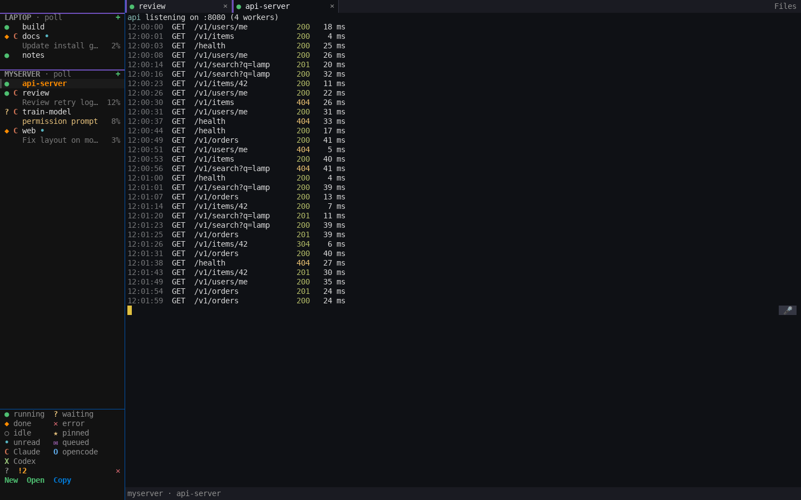
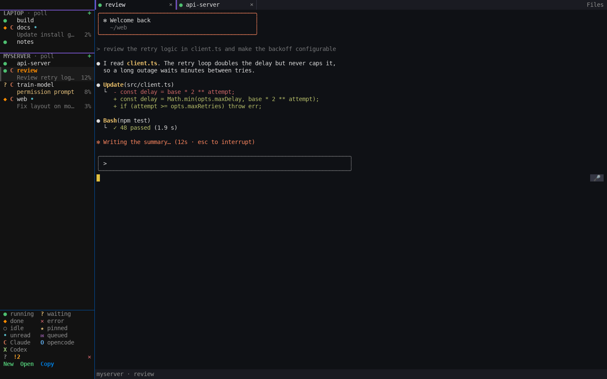
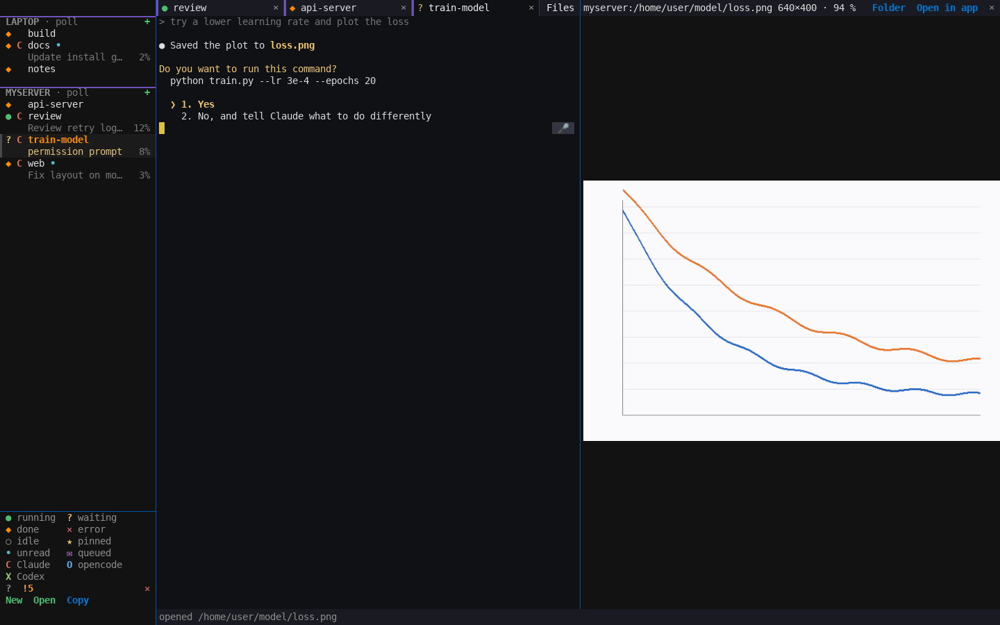

# tmls

One desktop window for your tmux sessions on every machine. The list on the left shows the
sessions of this machine and of your ssh hosts; click one and it attaches in a tab on the right.
The list knows what coding agents in those sessions are doing (Claude Code, Codex, opencode and
others), so you can see at a glance which one is working, which one waits on you, and which one
has finished.

tmls is a native app written in Rust (winit + wgpu, with Ghostty's terminal emulator). It runs on
Linux and Windows. It replaces an earlier Python/Textual version of tmls (not part of this repository).



## What it does

- **Sessions from every host in one list.** This machine (when it has tmux) plus the ssh hosts
  you name. The list is read again every 5 s; a host that does not answer shows as `· offline`
  and holds up no other host. Pinned sessions (`★`) sort first.
- **A status mark per session:** `●` running, `?` waiting on you, `◆` done since you last
  looked, `✕` error, `○` idle. A session with output you have not seen has `•` after its name.
- **Agent-aware.** For Claude Code, tmls reads Claude's own session status. For other agent CLIs
  (Codex, opencode, Gemini, Qwen, Kiro and more) it reads the pane's screen with
  [herdr](https://github.com/herdrdev/herdr)'s detection rules (see Credits).
- **Tabs.** Each attached session gets a tab (`tmux attach`, or `ssh HOST tmux attach`). A tab
  whose session ended or whose ssh dropped stays open and reattaches on Enter. Closing a tab
  detaches; the session keeps running.
- **Approve and message agents from the list.** `y` answers a Claude permission prompt (the
  dialog is read again just before the key is sent). `s` sends a saved or typed message; to a
  busy session it is queued and sent at the end of its turn.
- **Alerts.** A bell counts sessions that turned `?`, `◆` or `✕`; click it for the list and jump
  to the session. Desktop notifications for `?` and `◆` (`notify-send` on Linux).
- **Files and images.** Ctrl+click a URL to open it, or a file path to show the file (or picture)
  in a panel beside the terminal, read from the session's own host. Alt+Shift+F lists the images
  the session made. Pasting an image from the clipboard, or dropping an image file on a tab (Linux),
  puts it on the session's host and pastes its path.
- **Session management.** New session (host, folder, name, and what to start: a shell, `claude`,
  or your own agent presets), rename, kill (with a confirm), open in a new terminal window, copy
  the attach command.
- **Go-to picker** (Alt+Shift+G, or `g` in the list) over every session of every host, narrowed
  as you type.
- **Voice dictation (Linux, optional).** A mic button over Claude Code's input box sends speech to
  a local speech-to-text engine running in a Docker container named `voice-engine`. The engine is
  not part of this repo; without it the button does nothing.
- **Claude outside tmux.** Claude Code sessions on this machine that run in no tmux pane are
  listed too; a click brings their [kitty](https://sw.kovidgoyal.net/kitty/) window to the front.

tmux is needed on the machines whose sessions you want to see, not on the one that runs tmls.





## Build

Everything builds in Docker; nothing needs to be installed on the host besides Docker.

```sh
git clone https://github.com/sagunkayastha/tmls
cd tmls
```

### Linux

```sh
docker build -t tmls-rs-build:latest -f tooling/docker/Dockerfile.build tooling/docker
tooling/docker/build.sh build --release -p desktop
```

The binary is `target-docker/release/tmls-rs`. The first build fetches and builds Ghostty's
terminal library (it needs network; the image carries the Zig version it needs).
`tooling/desktop/install.sh /abs/path/to/tmls-rs` adds the icon and a `.desktop` entry under
`~/.local/share` (`uninstall.sh` removes them).

### Windows

The Windows exe is cross-built on Linux with mingw-w64 (target `x86_64-pc-windows-gnu`):

```sh
docker build -t tmls-rs-build:latest -f tooling/docker/Dockerfile.build tooling/docker
docker build -t tmls-rs-win-probe:latest tooling/win
tooling/win/check.sh build --release -p desktop --target x86_64-pc-windows-gnu
# writes target-win/x86_64-pc-windows-gnu/release/tmls-rs.exe
```

Copy `tmls-rs.exe` to the Windows machine and run it. It needs the OpenSSH client that ships
with Windows (`ssh.exe`) for remote hosts. On Windows there is no shared ssh connection
(ControlMaster), so every listing opens its own connection.

To list the tmux sessions of a WSL distro as this machine's, create `%USERPROFILE%\.config\tmls\wsl`
(empty for WSL's default distro, or with the distro's name on its first line).

### Android

There is no Android app for this Rust version. The earlier Python version had a web front end and an
Android wrapper around it; they are not part of this repository.

## Use

```sh
tmls-rs                 # this machine plus the hosts in ~/.config/tmls/hosts
tmls-rs devhost nas    # this machine plus these ssh hosts
tmls-rs --foreground    # stay attached to the terminal (logs on stdout)
tmls-rs keys            # print the key table
```

`tmls-rs` returns the shell at once and runs on as its own process. Its log is
`~/.cache/tmls-rs/tmls-rs.log` (the last run only).

Hosts are whatever `ssh HOST` accepts, so put aliases and keys in `~/.ssh/config`. Listing never
asks for a password (`BatchMode`): a host that needs one shows as offline. Attaching runs ssh
inside the tab, so a prompt from ssh shows there.

### Config

All files are in `~/.config/tmls/` (on Windows `%USERPROFILE%\.config\tmls\`) and all are optional.

| File | Use |
| --- | --- |
| `hosts` | ssh hosts to list, one per line; `#` starts a comment |
| `name` | what this machine is called in the list (default: its hostname) |
| `host-colors.json` | accent colour per host, e.g. `{"devhost": "green"}` (`blue`, `teal`, `violet`, `green`, `amber`, `rose`) |
| `agent-presets.json` | extra Start choices for a new session, as argv lists, e.g. `{"Opus plan": ["claude", "--model", "opus"]}` |
| `prompts` | saved messages for the Send form, one per line |
| `notifications.json` | `{"desktop": false}` turns notifications off; `{"silence_focused": false}` alerts for the tab in front too |
| `pins` | pinned sessions (written by the app) |
| `top` | session names to list first, above every host, one per line (e.g. a long-running coordinator session); empty by default |
| `top.json` | how to start that session again when it is gone: `{"name": "lead", "folder": "~/lead", "command": "claude --name lead", "default_home": "devhost"}` (optional `home_file`: a file on the hosts whose first line names the machine). Its `name` goes on top too |
| `wsl` | Windows only, see above |

Example `hosts`:

```
# ~/.config/tmls/hosts
devhost
nas      # off most of the time
```

Environment: `TMLS_RS_POLL_S` (listing period in seconds, default 5),
`TMLS_RS_NO_CONTROLMASTER=1` (no shared ssh connection).

### Keys

`?` in the app shows the full table.

```text
Everywhere
  Ctrl+Q              quit; the sessions keep running
  Ctrl+= / Ctrl+-     font size
  Alt+Shift+→ / ←     next / previous tab
  Alt+Shift+↑         keys to the session list
  Alt+Shift+G         go to any session
  Alt+Shift+N         next session that waits, else unread
  Alt+Shift+A         send a message to this tab
  Alt+Shift+W         close the tab (session lives)
  Alt+Shift+F         images this session made
  Alt+Shift+X         close the file panel

List
  j / k  ↑ / ↓        move
  Enter / click       attach
  Esc                 keys back to the terminal
  p / middle-click    pin or unpin
  c                   new session on this host
  m / right-click     the session's menu
  a                   alerts
  y                   approve a permission prompt
  s                   send or queue a message

Terminal
  Ctrl+Shift+C / V    copy / paste
  drag                select (Shift+drag when tmux has the mouse)
  Ctrl+click          open a link or a file
  Shift+wheel         scroll this window, not tmux
```

More detail on every feature: [docs/desktop-v0.md](docs/desktop-v0.md).

## Tests

```sh
tooling/docker/build.sh test -p client-core -p desktop    # unit and PTY tests, no window
tooling/smoke/run.sh                                      # headless end-to-end run in a container
```

The end-to-end run starts the app under a headless sway with its own tmux server and a scratch
`HOME`; it never sees your sessions or config.

## Credits

tmls stands on other people's work. Thank you to:

- **[herdr](https://github.com/herdrdev/herdr)** (Apache-2.0). The agent-detection rule files in
  `crates/client-core/agent-detection/` are copied unchanged from herdr (the commit is named in
  `NOTICE` there, with herdr's licence beside it), and `crates/client-core/src/detect.rs` is a
  port of herdr's detection engine. The go-to picker follows herdr's session picker.
- **[Ghostty](https://ghostty.org)** for its terminal emulator, used through
  [libghostty-rs](https://github.com/uzaaft/libghostty-rs) (`libghostty-vt`).
- **[wgpu](https://github.com/gfx-rs/wgpu)**, **[winit](https://github.com/rust-windowing/winit)**,
  **[cosmic-text](https://github.com/pop-os/cosmic-text)** and **[swash](https://github.com/dfrg/swash)**
  for the window, the GPU drawing and the text.
- **[portable-pty](https://github.com/wezterm/wezterm/tree/main/pty)** from WezTerm, for the PTY
  (ConPTY on Windows).
- **[arboard](https://github.com/1Password/arboard)** (clipboard), **[image](https://github.com/image-rs/image)**
  (pictures), **[regex](https://github.com/rust-lang/regex)**, **[toml_edit](https://github.com/toml-rs/toml)**
  and **[serde](https://serde.rs)**.
- **[tmux](https://github.com/tmux/tmux)**, which does the real work of keeping sessions alive.
- **[kitty](https://sw.kovidgoyal.net/kitty/)**'s remote control, for bringing a Claude window to the
  front.

The full dependency list, with licences, is in `Cargo.lock`.

## Licence

Dual-licensed under either of [MIT](LICENSE-MIT) or [Apache-2.0](LICENSE-APACHE), at your option.
The herdr rule files keep their own Apache-2.0 licence.
